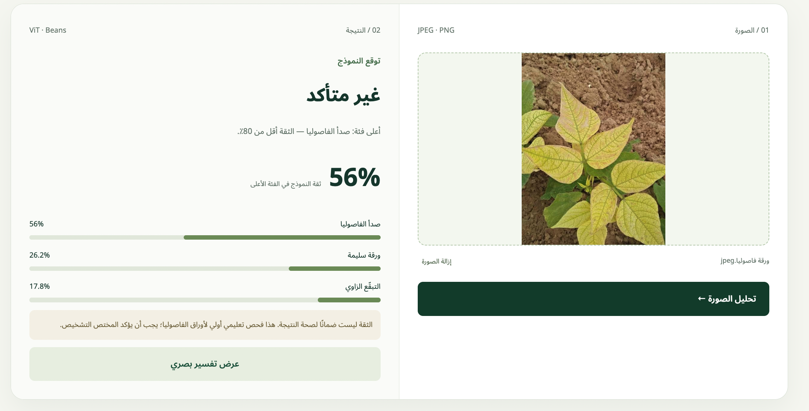
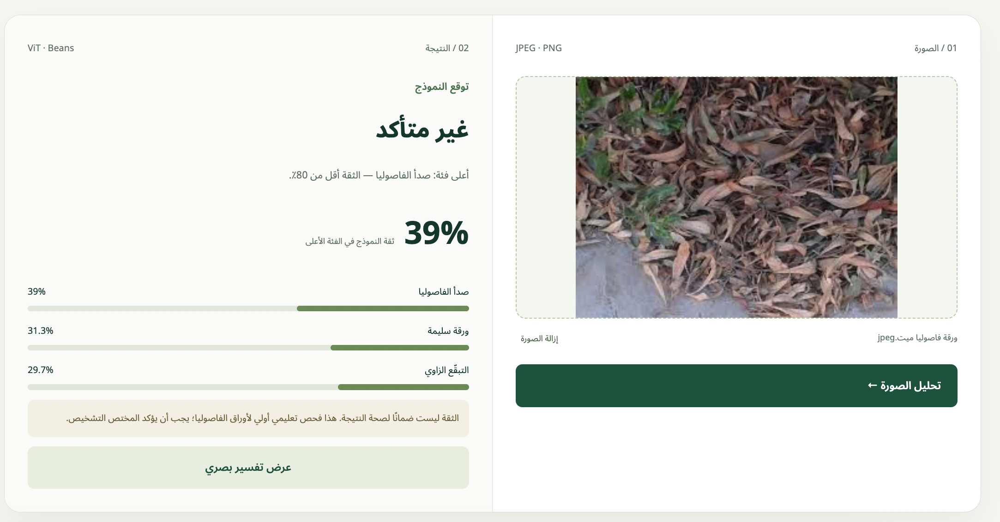
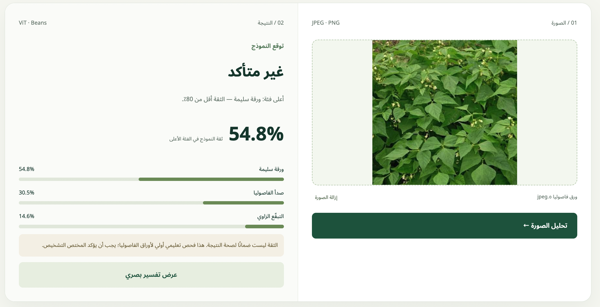

# Bean Leaf Vision — مشروع مسار الرؤية

خدمة تعليمية لتصنيف صور أوراق الفاصوليا: `angular_leaf_spot`، `bean_rust`، `healthy`.
النموذج جاهز ومدرّب مسبقاً؛ لم ندرّبه. أُنجز العمل المحلي بمساعدة الوكيل، ويجب على المجموعة مراجعة الشرح والسجل قبل التسليم.

## النتائج المقاسة

- 124 من 128 صورة صحيحة: **96.875%**؛ خط الأساس **33.59375%**.
- تطابق خمس صور مع حسابات الدفتر قبل إعادة التنظيم، بهامش `1e-5`.
- ثبات التصنيف بعد زيادة الإضاءة 10%: **100%**؛ وبعد دوران 5 درجات: **98.4375%**.
- 36 اختباراً ناجحاً؛ تغطية الكود **95%** في التشغيل المسجل.
- تم تشغيل API فعلياً واختبار طلب توقع وفتح `/docs`.
- Docker بُني وشُغل: healthy، مستخدم 10001، وتطابق خمس صور عبر الحاوية. حجم الصورة 1886.2 MiB.
- ملفات GitHub Actions جاهزة؛ راجع حالة طلب الدمج للفحوص السحابية. حماية الفرع والنشر بعد الدمج لم يُنفذا.

الأدلة: `evidence/tests.txt`, `evidence/notebook-run.txt`, `evidence/behaviour.json`, `evidence/api-smoke.json`.

## ابدأ هنا

من مجلد المشروع، باستخدام Python 3.12:

```bash
python3.12 -m venv .venv
source .venv/bin/activate
python -m pip install --extra-index-url https://download.pytorch.org/whl/cpu -r requirements-dev.lock
python scripts/download_model.py
python -m uvicorn bean_vision.api:app --app-dir src --host 127.0.0.1 --port 8000 --no-access-log
```

في Windows، فعّل البيئة عبر `.venv\Scripts\Activate.ps1`، واستعمل `curl.exe` بدلاً من `curl`.

افتح http://localhost:8000/docs، ثم `/v1/predict` ← **Try it out** ← ارفع `tests/fixtures/leaf-0.png` ← **Execute**.

```bash
curl -F 'file=@tests/fixtures/leaf-0.png;type=image/png' http://localhost:8000/v1/predict
curl -F 'file=@tests/fixtures/leaf-50.png;type=image/png' http://localhost:8000/v1/explain -o explanation.png
python scripts/smoke.py http://localhost:8000
```

`explain` أبطأ: يختبر 169 تغطية جزئية. اللون الأزرق يعني أن إخفاء المنطقة خفّض ثقة النموذج، وليس أن المنطقة مثبتة الإصابة.

## بنية المشروع

```text
src/bean_vision/
  domain.py          قاعدة القرار والفئات؛ لا يستورد إطار الويب أو النموذج
  service.py         ينسق التوقع من خلال واجهة قابلة للاستبدال
  settings.py        حد الثقة والحجم والمسارات وإعدادات الأسرار
  adapters/images.py التحقق من الصورة وتحويلها إلى RGB
  adapters/model.py  تجهيز 224×224 وتشغيل النموذج والتفسير
  api.py             الطلبات والردود والأخطاء والجاهزية
scripts/             تنزيل النموذج وتجربة التشغيل والكسر المقصود
tracks/vision/       الدفتر الأصلي مع إصلاح تحميل البيانات موثق
tests/              اختبارات البرنامج والنموذج وصور مرجعية صغيرة
secrets/             قيمة تدريبية مشفرة؛ لا يوجد مفتاح خاص هنا
.github/workflows/   الفحص والبناء والنشر واختبارات النموذج
```

اتجاه الاعتماد: API → service → domain. محول النموذج يحقق الواجهة التي يحتاجها service. لتغيير النموذج نعدل المحول؛ لتغيير حد الثقة نعدل الإعدادات.

## عقد الخدمة

| المسار | الغرض |
|---|---|
| `GET /health` | البرنامج حي |
| `GET /ready` | النموذج محمّل، أو 503 إذا تعذر تحميله |
| `POST /v1/predict` | صورة JPEG/PNG في حقل multipart اسمه `file` |
| `POST /v1/explain` | الصورة نفسها؛ يرجع PNG لخريطة التفسير |

الحد الافتراضي 5 MiB للصورة و16 مليون بكسل. الطلبات المتزامنة أثناء انشغال النموذج تحصل على 429 لإعادة المحاولة.

رد حقيقي مختصر للصورة 0:

```json
{"label":"angular_leaf_spot","confidence":0.9432013,"not_sure":false,"decision":"angular_leaf_spot","model_version":"1.0.0"}
```

يتضمن الرد الكامل درجات الفئات الثلاث وتنبيهاً لحدود الاستخدام. أقل من 80% يعيد `decision: "not_sure"`، مع الاحتفاظ بأعلى فئة في `label` لتوضيح حساب النموذج.

الأخطاء لها الشكل نفسه، مثل:

```json
{"error":{"code":"unsupported_type","message":"Use a JPEG or PNG image"}}
```

## الاختبارات

```bash
python -m pytest -m 'not real' -q
python -m pytest -m real -q
python -m pytest --cov=bean_vision --cov-report=term-missing
python scripts/deliberate_break.py
ruff check src tests scripts
```

تحتاج اختبارات `real` تنزيل النموذج والاتصال الأول لتنزيل بيانات الاختبار. غياب النموذج يفشل الاختبار ولا يحوله إلى نجاح أو تخطٍ صامت.
الكسر المقصود يعكس قاعدة الثقة في عملية Python منفصلة؛ ظهور فشل اختبارين هو النتيجة المتوقعة لهذه التجربة، ولا يغير المصدر.

## الحاوية والأتمتة

```bash
docker compose up --build -d
python scripts/smoke.py http://localhost:8014
docker compose ps
docker compose exec api id
docker image inspect bean-vision:local --format '{{.Size}}'
```

بعد تشغيل Compose افتح http://localhost:8014/docs. المنفذ 8014 افتراضي لتجنب التعارض؛ لتغييره استخدم متغير BEAN_PORT.

اختيارنا الأول PyTorch CPU للحفاظ على سلوك الدفتر. يثبت `requirements.lock` إصدارات المكتبات ويثبت `model_manifest.json` مراجعة النموذج والبيانات. النموذج داخل الصورة النهائية؛ التشغيل لا يحتاج تنزيله ولا مفتاحاً. المستخدم `10001`، ونظام الملفات للقراءة فقط في Compose، والمنفذ محلي. صور Python الأساسية ذات وسم متحرك وليست digest ثابتاً؛ ذلك حد معروف لإعادة الإنتاج التامة. تحسين ONNX اختياري يحتاج قياس تطابق وحجم مستقلين.

خط CI يفحص التنسيق والاختبارات والأسرار، يبني الحاوية ويجربها، ثم ينشر إلى GHCR عند الدفع إلى `main` فقط. اختبارات النموذج تعمل على طلبات الدمج وأسبوعياً. راجع `GITHUB_SETUP.ar.md` قبل النشر.

## القيود

ثقة 95% لا تعني ضمان الصحة. الصور من بيانات حقول أوغندا، والتقييم صغير ومحدد بثلاث فئات. النموذج لا يكتشف تلقائياً المحاصيل الأخرى أو الأمراض غير المعروفة. لا تتخذ قرار رش أو إتلاف محصول اعتماداً عليه وحده. هذه خدمة تعليمية محلية، وليست خدمة عامة محمية بالمصادقة ومجهزة لأحمال إنتاجية.

## ملفات التسليم

- `JOURNAL.md`: مسودة سجل المراحل؛ راجعوها وأضيفوا الأسماء والشرح الشخصي.
- `WALKTHROUGH.ar.md`: دليل العرض والأسئلة مع الإجابات.
- `SECURITY.ar.md`: مسار الأسرار وخطة الاستجابة للتسرب.
- `GITHUB_SETUP.ar.md`: ما تبقى على GitHub.
- `evidence/`: النتائج المقاسة والصور؛ لا تستبدلها بادعاءات غير متحققة.

مصادر المشروع: https://aie113.ibrahimalshehri.sa/#project وhttps://github.com/snow10100/aie113-projects.

## واجهة المستخدم — بصيرة

افتح http://localhost:8014/ بعد تشغيل Docker. ارفع صورة JPEG أو PNG بحجم لا يتجاوز
5 ميجابايت، ثم اضغط «تحليل الصورة». تظهر معاينة الصورة والتصنيف ودرجات الفئات الثلاث.
عند ثقة أقل من 80٪ تعرض الواجهة «غير متأكد». الثقة ليست ضمانًا لصحة التشخيص.
زر «عرض تفسير بصري» يطلب خريطة الإخفاء من النموذج وقد يستغرق دقيقة؛ ليست خريطة لتحديد المرض.

الواجهة عربية ومتجاوبة، وملفاتها في `src/bean_vision/static/`. تخدمها FastAPI من نفس
المنفذ، لذلك لا تحتاج Node أو خادمًا إضافيًا. الخط الخارجي اختياري مع بديل محلي.
الصورة تُرسل لخدمة المشروع للتحليل؛ الواجهة لا تضيف حفظًا للصور.

## صور من تجربة الواجهة

لقطات أرسلتها المجموعة توضح ظهور «غير متأكد» عندما تكون أعلى درجة أقل من 80٪.
هذه درجات النموذج المعروضة في التجربة، وليست تشخيصات مؤكدة أو قياسًا لدقة النموذج.

### أوراق صفراء — أعلى درجة 56٪


### أوراق جافة — أعلى درجة 39٪


### أوراق خضراء — أعلى درجة 54.8٪

